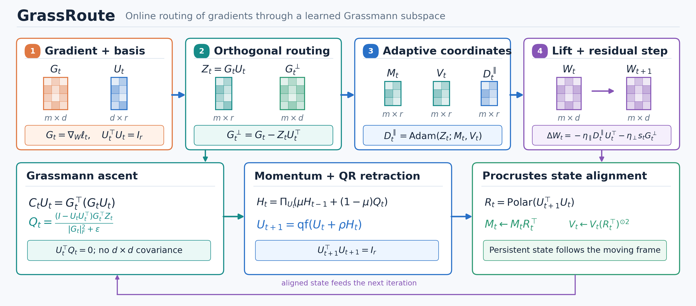

<h1 align="center">GrassRoute</h1>

<p align="center"><strong>Online Gradient Routing on the Grassmann Manifold</strong><br />
Research code for memory-efficient, geometry-aware optimization.</p>

<p align="center">
  <a href="paper/main.pdf"></a>
  <a href="#method-at-a-glance"></a>
  <a href="#reproducing-experiments"></a>
  <a href="assets/grassroute_intuition.png"></a>
</p>

<p align="center">
  
</p>

<div align="center"><sub>The diagram is a PNG; its drawing code is in <a href="assets/draw_intuition.py">assets/draw_intuition.py</a>.</sub></div>

## Method at a glance

For a matrix gradient $G_t$ and a learned orthonormal routing basis $U_t$, GrassRoute computes $Z_t=G_tU_t$ and $G_t^{\perp}=G_t-Z_tU_t^\top$. An Adam-style update acts in the small $m\times r$ coordinate space; a scaled residual update preserves the orthogonal gradient without full-size optimizer moments. A Grassmann tangent step, QR retraction, and Procrustes alignment update the routing basis and its stored state.

The complete update, implementation choices, and conditional theory are in the [paper](paper/main.pdf).

## Quick start

```bash
git clone https://github.com/Hik289/manifold-grassman-optimization.git
cd manifold-grassman-optimization
python3 -m venv .venv
source .venv/bin/activate
python -m pip install -r requirements.txt
python examples/optimizer_step.py
python experiments/test_numerics.py
```

`examples/optimizer_step.py` is a short, synthetic optimizer example. The numerical check runs the eight geometry and decomposition assertions in `experiments/test_numerics.py` and needs no downloaded dataset.

## Reproducing experiments

Install optional training and reporting dependencies with `python -m pip install -r requirements-experiments.txt`. Choose a writable data directory using `export GR_DATA_ROOT=/path/to/datasets`; the legacy entry points also accept `GRASSROUTE_DATA_ROOT`. Dataset preparation code downloads public corpora when needed. GPU and graph experiments require a compatible PyTorch/PyG installation.

| Track | Command | Notes |
| --- | --- | --- |
| Synthetic optimizer smoke test | `python revision/suite.py --smoke --tasks matreg_128 --methods GrassRoute` | Two steps, no external data |
| Original task runner | `python experiments/train.py --family matreg --baseline B5 --epochs 2 --out_dir experiments/runs` | Historical single-task entry point |
| Public task preparation | `python revision/prepare_new_tasks.py --family all` | Downloads and preprocesses six public tasks |
| Public task suite | `python revision/new_tasks_suite.py --register` | Writes the frozen task protocol before training |
| Loss figures | `python revision/core_loss.py` and `python revision/new_tasks_report.py` | Uses the bundled frozen figure trajectories |

The full six-method protocols additionally use the **upstream SubTrack++ baseline**. Install the pinned external source with `bash scripts/install_subtrack.sh`. Its repository is fetched on demand, rather than copied into this repository. Run the scripts from the repository root; the experiment code writes generated outputs under `revision/` or `experiments/runs/`.

The bundled JSON trajectories are the inputs to the four loss plots in the paper. Validation-screen summaries are also retained for the public-task report. Large raw datasets, model checkpoints, screen trajectories, server logs, and machine-specific job state are omitted. The paper retains all reported outcomes, including stronger or unfavorable baselines; the selected plots are not an overall win-rate summary.

## Evidence and scope

| Evaluation | What the stored run supports |
| --- | --- |
| Archived Burgers PINN | Lower reported training objective than AdamW and periodic SVD in the archived single-seed comparison |
| Independent Cora graph check | A favorable original comparison; additional initializations did not consistently retain the accuracy gain |
| SMS classification | A memory–quality trade-off: substantially less optimizer state with a stated macro-F1 cost |
| Six new public tasks | Full six-method matrix is reported; none establishes a primary-metric win over both AdamW and periodic thin SVD |

These tracks have different protocols. See the paper's Experiments and full appendix before comparing numbers across them. The stored results do not establish statistical significance.

## Repository map

```text
experiments/       original optimizer, baselines, model families, training and ablations
revision/          validation-selected suites, follow-ups, recovery, analysis and plotting
eda/               early gradient-spectrum and task-family probes
archive/           distinct historical optimizer/source versions and legacy figure code
paper/             LaTeX source, bibliography, figure PDFs and compiled manuscript
assets/            README intuition PNG and reproducible drawing script
examples/          minimal optimizer invocation
scripts/           external baseline setup
```

The code in `archive/` documents earlier experimental versions; current formal follow-ups use `revision/`. Archived `B6` is a local surrogate and is not the pinned official SubTrack++ implementation. The official baseline is loaded by the revision runners after the setup script downloads it.

## Citation

```bibtex
@misc{grassroute2027,
  title  = {GrassRoute: Online Gradient Routing on the Grassmann Manifold},
  author = {Anonymous Authors},
  year   = {2027},
  note   = {ICML 2027 working draft}
}
```

The repository contains a working draft. The included LaTeX source currently uses the bundled `icml2026` style while the manuscript is prepared for a future submission.
